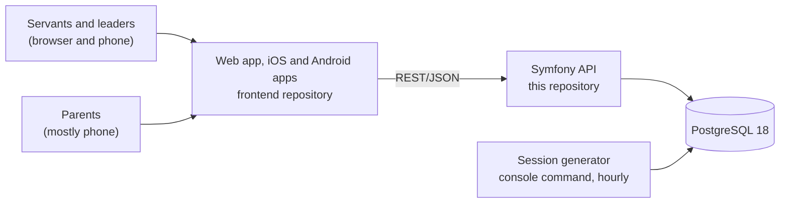

# Architecture

KHMK Köln is an app for the church's servants and for parents. Servants run their services (Sunday School,
Youth Meeting, …): they plan meetings, take attendance, prepare lessons and give small homework tasks.
Parents follow their children's homework in a parent portal.

The MVP covers services and stages, meeting schedules and sessions, manual attendance (also on the phone),
a minimal member list, lesson preparation, homework and the parent portal, together with sign-in and
registration with an administrator's approval, data protection requests, three languages (English, German,
Arabic) and a dark mode. QR check-in, follow-up, visitation, events, pastoral care, appointments and welfare
are not part of it.

## Building blocks

| Repository | Contents | State |
| --- | --- | --- |
| `backend` (this one) | Symfony 8.1 API on PHP 8.4.1+, Doctrine ORM 3 and Migrations, PostgreSQL 18 (`compose.yaml` for local development) | Initialized, no features |
| `frontend` | Next.js 16 web app as a static export, packaged as iOS and Android apps with Capacitor 8; shadcn/ui with preset `b3a10z1gt0` | Initialized, no features |
| `ui` | The clickable prototype (`ui-prototype`) and its screenshots (`ui-mockups`) | Complete for the MVP screens |

The prototype is documentation, not product code. It shows the screens and the agreed rules, and its mock
layer behaves like this API should. Features are built in `frontend` and here through tickets; code from the
prototype can be reused where it fits, but nothing is copied over wholesale. Frontend-specific decisions are
in the frontend repository's `docs/architecture.md`.

## Decisions

### Symfony 8.1 instead of 7.4 LTS

We start on the latest stable Symfony, 8.1, as requested. It needs PHP 8.4.1 or newer. 8.1 is a standard
release with bug fixes until the end of January 2027; 8.2 follows in November 2026 and 8.4, the next LTS,
in November 2027. Staying current therefore means a minor upgrade about every six months. Minor upgrades
within 8.x are backward compatible, so each is small if deprecations are fixed as they appear. The
alternative was 7.4 LTS (bug fixes until November 2028) on PHP 8.2+. If the team prefers fewer upgrades,
switching to 7.4 now costs little, because the backend has no features yet.

### API style

- REST with JSON bodies, camelCase names, UUIDv7 ids.
- Errors as RFC 9457 problem details: 403 (role does not allow it), 404, 409 (a business rule forbids it
  right now) and 422 (field errors keyed by field name). The prototype's mock layer already returns these
  shapes, so the screens' error handling carries over.
- Every problem and every field error carries a stable code and its parameters, e.g.
  `{"code": "services.hasHistory", "params": {"name": "Choir", "count": 12}}`, next to an English `detail`
  for logs. The apps show the text for the code in the person's language. The prototype's message keys
  under `errors.*` (in `ui-prototype/messages/en.json`) are the proposed codes.
- Calendar dates as `YYYY-MM-DD` in the church's time zone (Europe/Berlin), instants as RFC 3339 with an
  offset. See the [data model](data-model.md).

### Clients call the API cross-origin

The frontend is a static build that runs in the browser and, bundled, inside the iOS and Android apps. Every
request therefore comes from client-side code: from the web app's origin, from `capacitor://localhost` in the
iOS app and from `https://localhost` in the Android app. The API needs a CORS allowlist with these origins and
a sign-in method that works without third-party cookies. Bearer tokens work the same in all three; session
cookies would need Capacitor's native HTTP in the apps. The sign-in ticket decides. The parked spike used a
session cookie, which would need revisiting.

### Accounts need an administrator's approval

Parents and servants register themselves: name, email, password, whether they are a parent or a servant,
and a note (their children's names and classes, or where they serve), after accepting the privacy notice.
The account exists from then on but can't be used: signing in with the right password only shows that it
is waiting. An administrator approves it in Settings › Account requests, and the approval is where access
is decided: a parent's account is linked to the children the office has checked (approved guardian links),
a servant gets a role in a service, optionally narrowed to a stage. Declining deletes the account and
everything the person entered. Accounts the office creates itself are approved at once.

Sign-in answers "wrong email or password" without saying which, and "forgot password" always answers the
same, so neither can be used to find out who has an account. Before an administrator sees a registration,
the person should confirm their email address through a link (not in the prototype). Disabled accounts
can't sign in and keep their history. The open question of tokens or cookies stays (see above).

### Three languages, right to left included

The apps speak English, German and Arabic, and Arabic is laid out right to left. Texts live in the
frontend; the API sends codes and data, never sentences (see API style). Dates go over the wire as
`YYYY-MM-DD` and instants with an offset, and the apps format them. Each account stores its language
(`en`, `de` or `ar`), set when the person chooses one, so emails and notifications use it.

### Data protection (DSGVO)

The app stores as little as the work needs: no photos, addresses, birthdays or grades. Because belonging
to a church's groups reveals a religious affiliation, all of it is treated as special-category data
(DSGVO Art. 9): it never leaves the church, every request is checked against the roles, and parents only
ever see their own children.

People's rights are handled in the app:

- **Copy (Art. 15, 20):** everyone can download what is stored about them as JSON from their account page.
  The office records requests that come by email, letter or in person and downloads the copy for the person.
  Other people's contact details are left out (Art. 15(4)).
- **Erasure (Art. 17):** people ask from their account page, or the office records the request. An
  administrator reviews what the app stores, including free-text notes that may name the person, and
  erases it in one step (see the [data model](data-model.md#data-protection)). Past attendance totals stay
  right as anonymous numbers. An administrator can't erase their own account.
- **Deadline:** each request must be answered within one month of arrival (Art. 12(3)); the request log
  shows the due date and warns a week before.
- **Accountability:** the request log keeps the dates, the outcome and counts of what was deleted. Once the
  data is erased the log no longer names the person ("Erased member of 3rd Class").

The privacy notice (`/privacy` in the prototype) is a draft for the church's data protection adviser, who
also has to confirm the legal bases and the retention periods (see open questions).

### Who may do what

Roles are administrator, service leader, servant and parent. Leader and servant roles are scoped to one
service, and a servant's role can be narrowed to one stage (Daniel serves Sunday School › 3rd Class).
Parents have no service roles: they see only the children an administrator linked to their account. The
API checks permissions on every request; the frontend only hides what a person can't do. Parents receive
only what they need: published homework, the passage and memory verse, never lesson plans, notes,
attendance or other families.

### Sessions are created the day before

Schedules describe recurring meetings. A console command, run every hour at minute 5, creates each
session on the calendar day before it takes place and is safe to run any number of times. Lessons are
linked to a meeting by schedule and date, not by session, so servants can prepare weeks ahead. The command
is designed but not built; the prototype simulates it.

### Attendance records presence only

Servants mark people present. Not marked present is not the same as absent, and the MVP records no
absences or excuses. Closing attendance freezes the list; a service leader can reopen it for corrections,
and corrections keep their history.

### Homework is reported, not graded

Parents tick a task off; undo is possible. Staff see who reported what. There are no grades, scores or
rankings, and the wording stays gentle ("Was due yesterday", never "overdue").

## Open questions for tickets

- Sign-in: bearer tokens or cookies (see above). Passwords are the proposal (the prototype has them); email
  links remain an option for parents.
- Email delivery: confirming the address after registration, password links, approval and erasure
  notices, in the person's language. Which provider (an EU one).
- How the office verifies a parent before linking a child (in person after the liturgy is the prototype's
  suggestion), and who can make data protection requests for a child.
- Data protection, with the church's adviser: the controller and the contact in the privacy notice; the
  legal bases (Art. 9(2)(d) for members, consent for the parent portal?); how long members who left and
  disabled accounts are kept; how long backups keep erased data; the data processing agreement with the
  host; whether a data protection impact assessment is needed.
- Hosting, deployment, backups and monitoring; whether the web app is served from the API's domain.
