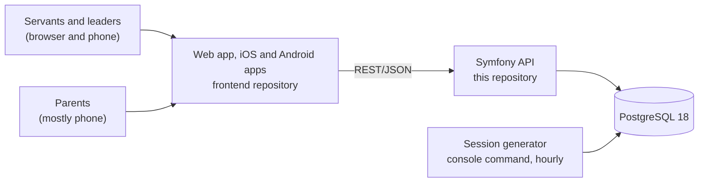

# Architecture

KHMK Köln is an app for the church's servants and for parents. Servants run their services (Sunday School,
Youth Meeting, …): they plan meetings, take attendance, prepare lessons and give small homework tasks.
Parents follow their children's homework in a parent portal.

The MVP covers services and stages, meeting schedules and sessions, manual attendance (also on the phone),
a minimal member list, lesson preparation, homework and the parent portal, together with sign-in and
registration with an administrator's approval, data protection requests, three languages (English, German,
Arabic) and a dark mode. QR check-in, follow-up, visitation, events, pastoral care, appointments and welfare
are not part of it.

## Building blocks

| Repository | Contents | State |
| --- | --- | --- |
| `backend` (this one) | Symfony 8.1 API on PHP 8.5, Doctrine ORM 3 and Migrations, PostgreSQL 18 (`compose.yaml` for local development) | Initialized, no features |
| `frontend` | Next.js 16 web app as a static export, packaged as iOS and Android apps with Capacitor 8; shadcn/ui with preset `b3a10z1gt0` | Initialized, no features |
| `ui` | The clickable prototype (`ui-prototype`) and its screenshots (`ui-mockups`) | Complete for the MVP screens |

The prototype is documentation, not product code. It shows the screens and the agreed rules, and its mock
layer behaves like this API should. Features are built in `frontend` and here through tickets; code from the
prototype can be reused where it fits, but nothing is copied over wholesale. Frontend-specific decisions are
in the frontend repository's `docs/architecture.md`.

## Code layout

A modular monolith with bounded contexts, based on `bisort-console`. `src/` holds exactly five top-level
namespaces, and calls go one way: **Interface → Workflow → Context**.

| Namespace | Holds |
| --- | --- |
| `App\Interface` | Entry points and the shapes they exchange, nothing else: `Api/<Area>/<Name>Controller`, `Api/<Area>/Request/<Name>Request` (the `#[MapRequestPayload]` DTOs with their `#[Assert]` constraints, strings and lists only), `Api/<Area>/Response/<Name>Response` (the JSON an endpoint answers, built with `::of()` from a workflow model), `Console/<Area>/<Name>Command` and `Console/<Area>/Request/<Name>Request`. Interface calls workflows only and never names a context class. The parent portal is `Api/ParentPortal`. |
| `App\Workflow` | One class per process: `<Area>/<Verb><Subject>Workflow`, run through its only public method `__invoke()`. A workflow sequences the application services of one or more contexts, holds the transaction when several writes must succeed together, checks access, and maps what the contexts return to its models in `<Area>/Model/` (final readonly, scalars, lists and other models). It is the only code that uses the contexts. |
| `App\Context` | The bounded contexts: `Identity`, `Organization`, `People`, `Meetings`, `Attendance`, `Learning`. Each has `Application/Service` (the business logic), `Domain` (the model: `Entity`, `ValueObject`, `Enum`, `Repository` interfaces, the `Interface` contracts that its `Infrastructure` or its own rule classes implement, `Exception`, `Attribute`) and `Infrastructure` (Doctrine repositories, migrations, Symfony integrations). |
| `App\Library` | Business-agnostic packages, each split into `Client`, `Model` and `Exception` (and `Mapping` for Doctrine mapped superclasses that entities extend); they wrap PHP's native functions once for the rest of the application (see [Code style](code-style.md)): `Strings` (`Text`, `InputText`, `NameKey`), `Types` (`Type`), `Collections` (`Collections`, next to Doctrine's collections), `Files` (`Path`), `Console` (`HiddenPrompt`), `Problem` (the coded exceptions), `Time` (`LocalDate`, `LocalTime`, `Calendar`, on Carbon), `Persistence` (the `CreatedAtEntity` and `TimestampedEntity` mapped superclasses). Packages never use each other (`mago guard`); a package keeps only the methods something uses, and missing ones are added with their first caller. |
| `App\Platform` | The runtime: `Kernel`, `Migration`, `Health`, `Http`, `Logging`. Each module splits into `Contract` (interfaces the rest may use), `Service`, `Model` and `Command`. |

Rules, enforced by `mago guard` and the tests in `tests/Architecture`:

- Interface uses workflows, never a context (`InterfaceLayoutTest`). Nothing depends on Interface.
- Only workflows use the contexts. A workflow never calls another workflow and never uses a repository; it goes
  through the contexts' application services (`WorkflowLayoutTest`).
- Workflow models are built from values. The workflow calls the contexts' services and clients such as the
  `Calendar` and passes what they return; a model never receives a service (`mago guard`).
- Only workflows manage access. A workflow injects `AccessCheck` and calls `require()` itself. Models,
  controllers and context services never use `AccessCheck`, neither injected nor passed as an argument
  (`mago guard`). Read models carry no permission flags: clients take what the viewer may do from the
  `permissions` of `GET /api/me`.
- A context never uses another context. Only a context's own `Infrastructure` uses its `Infrastructure`.
  When a rule of one context needs another context's facts, the workflow reads them and hands them over in
  the receiving context's own value object: `OfferedMeetings` maps Meetings' `MeetingSlot` into Learning's
  `OfferedMeeting`, and `ArchivedStructure` carries Organization's archived ids into Meetings.
- `Domain` holds the model only (`SourceLayoutTest`), and business logic lives in `Application/Service`. Entities hold state and
  nothing else: the constructor assigns the value objects, entities and ids it is given (plus fixed starting
  values such as a new session's `scheduled` progress), getters return them or answer a question about that
  state (`isArchived()`), and changes replace a value or add or remove an item. An entity never validates or
  cleans input, builds value objects from raw values, branches, loops, throws, computes or decides; the
  application service does that and hands the entity finished values. A value object checks its own value
  (`ServiceName::of()`) and may compute from it (`Tenure::endedFrom()`). `EntitiesHoldOnlyStateTest` fails on
  control flow, closures, static factories and `::of()`/`::from()` calls in an entity.
- `Domain` and `Library` don't depend on `Platform`; outside `Platform`, code uses only `Platform/*/Contract`.
- Every application route lives under `/api` (class-level `#[Route]`).
- Code follows [Code style](code-style.md).

Naming:

| What | Where | Named | Shape |
| --- | --- | --- | --- |
| Controller | `Interface/Api/<Area>/` | `<Name>Controller` | final |
| Request | `Interface/Api/<Area>/Request/` | `<Name>Request` | final readonly |
| Response | `Interface/Api/<Area>/Response/` | `<Name>Response` | final readonly |
| Console command | `Interface/Console/<Area>/` | `<Name>Command` | final, invokable |
| Console request | `Interface/Console/<Area>/Request/` | `<Name>Request` | final, public properties Symfony fills through `#[MapInput]` |
| Workflow | `Workflow/<Area>/` | `<Verb><Subject>Workflow`: an imperative verb for a write (`RegisterAccount`, `GiveRole`), `Show` for one thing, `List` for many, `Check` for a probe | final readonly, only `__invoke()` public |
| Workflow model | `Workflow/<Area>/Model/` | a noun (`CurrentAccount`, `AccountDetails`) | final readonly |
| Application service | `Context/<C>/Application/Service/` | what it manages (`RoleAssignments`, `AccountRegistration`), never `*Service`, `*Manager` or `*Helper` | final readonly |
| Port | `Context/<C>/Domain/Interface/` | `*Interface` | interface |
| Repository | `Context/<C>/Domain/Repository/` | `*RepositoryInterface` | interface |
| Doctrine repository | `Context/<C>/Infrastructure/Persistence/Repository/` | `Doctrine<Entity>Repository`, or `Doctrine<Query>Repository` for a read query across entities (`DoctrineRosterRepository`); nothing else in the folder | final readonly |
| Repository filter | `Context/<C>/Infrastructure/Persistence/Repository/Filter/` | `<Entity>Filters` | final readonly, static methods that build the Doctrine `Criteria` of a listing |
| Repository writer | `Context/<C>/Infrastructure/Persistence/Repository/Writer/` | what it writes (`MissingSessions`) | final readonly, a write a Doctrine repository hands off |
| Exception | `Context/<C>/Domain/Exception/` | `*Exception` | class |
| Enum | `Context/<C>/Domain/Enum/` | a noun | backed enum |
| Entity | `Context/<C>/Domain/Entity/` | a noun | final, state only: no factories, rules or checks (`EntitiesHoldOnlyStateTest`) |
| Value object | `Context/<C>/Domain/ValueObject/` | a noun | final readonly |
| Attribute | `Context/<C>/Domain/Attribute/` | what it declares | final readonly |

Persistence (ADR 0004 of `bisort-console`):

- Each context owns one PostgreSQL schema (`identity`, `organization`, `people`, `meetings`, `attendance`,
  `learning`) and its own migration history (`<context>_migration_versions`). Its migrations live in
  `src/Context/<Context>/Infrastructure/Persistence/Migrations`.
- Every folder `src/Context/<Context>` is a context; its schema is the lower-case name. Migrations are
  applied by `app:migrations:migrate`, which migrates every context.
- Migration files are only ever created by a command, never by hand: `bin/console app:migrations:diff
  <context>` for a change to the mapping, `app:migrations:generate <context>` for an empty migration that
  holds SQL the mapping can't express (a table Doctrine doesn't map, a data change). The generated file is
  then edited only to add what the diff can't produce (CHECK constraints) and to complete `down()`.
- A context stores only the id of another context's record. No foreign keys cross schemas; the workflow checks
  references across contexts before it writes.
- A context's diff compares the database with a target made of the context's mapping plus every table the
  database already holds outside the context. Other contexts therefore never show up in the diff, and DBAL
  derives every schema from real tables.

Errors (the contract is in [API contract](api.md#problems)):

- Code raises `App\Library\Problem\Exception\RuleViolation(code, params, extensions)` for a broken business
  rule (409), `NotFound::of('service')` for a missing record (404 `notFound.service`) and
  `InvalidInput([field => {code, params}])` for field errors found by a service (422). Exception messages hold
  only the code; params and extensions never reach the logs.
- `Platform/Problem` turns every exception on an `/api` path into a problem: request payload errors,
  `AccessDeniedHttpException('<code>')`, a `NotFoundHttpException('<code>')` from `#[MapEntity(message:)]`,
  unique violations (409 `conflict`), and anything else as 500 `internal`, with `debug: {class, message}`
  only when `kernel.debug` is on.
  The exception that was thrown wins over the ones it wraps: translators try the chain outermost first, and
  the HTTP status of the outermost HTTP exception is the fallback.
- Request DTOs bound with `#[MapRequestPayload]` have nullable properties with defaults, so a missing field
  reaches its constraint; every constraint message is a code (`#[Assert\NotBlank(message:
  'services.nameRequired')]`). `ConstraintMessagesAreCodesTest` fails for a message that is not in the code
  catalog.
- A request checks only the shape of the input: presence, types, formats and choices. Rules that weigh values
  against each other belong to the context, which throws `InvalidInput` with the request's field path; for
  example `RecurrenceRules` (Meetings) checks a `RecurrenceDraft` and reports `recurrence.interval`.
- Adding a code: add it to its module in the code catalog of `docs/api.md`, and its en/de/ar texts as
  `errors.<code>` in the frontend.

Naming and Doctrine rules:

- `Service` (Organization) is the table `service` and `serviceId` in JSON; `Schedule` and `Session` (Meetings) are the tables `meeting_schedule` and `meeting_session`; `User` is the
  table `app_user`. Classes in a `Service` folder are services in the Symfony sense; the entity is the only class named
  `Service`.
- Entities create their UUIDv7 id in the constructor. The `$id` property is not `readonly`: when Doctrine loads a
  lazy reference it sets the id again with a new `Uuid` instance, which a readonly property refuses. For the
  same reason Doctrine can't refresh a managed entity whose readonly embeddables hold objects, so a lock
  (`SessionRepositoryInterface::withWriteLock()`, `HomeworkRepositoryInterface::withLock()`,
  `UserRepositoryInterface::withWriteLock()`) detaches a managed
  copy and loads the row again `FOR UPDATE`. Instants (`*_at`) are `datetimetz_immutable`.
- `created_at` and `updated_at` come only from the mapped superclasses in `App\Library\Persistence\Mapping`: an
  entity with `created_at` extends `CreatedAtEntity`, one with both extends `TimestampedEntity`. Their
  lifecycle callbacks stamp the fields on `PrePersist` (and `PreUpdate` for `updated_at`) from Symfony's
  clock, the one `Calendar` uses. Constructors, services and workflows never set them
  (`tests/Architecture/TimestampsComeFromLifecycleCallbacksTest`).
  References to an acting account are nullable: `ON DELETE SET NULL` inside Identity, set to null by the
  erasure process in the other contexts. Embeddables live in `Domain`.
- CHECK constraints and partial indexes are added to the generated migration by hand, written in the
  canonical form PostgreSQL prints back, so `app:migrations:diff` stays empty.

## Decisions

### Latest stable versions: PHP 8.5, Symfony 8.1, PostgreSQL 18

We start on the latest stable release of each, as requested (Symfony below). PHP 8.5 has active support
until the end of 2027 and security fixes until the end of 2029. PostgreSQL 18 is supported until November
2030; 19 is due after launch and is a major upgrade (`pg_upgrade` or dump and restore), done as its own
ticket.

### Symfony 8.1 instead of 7.4 LTS

Symfony 8.1 needs PHP 8.4 or newer. 8.1 is a standard release with bug fixes until the end of January
2027; 8.2 follows in November 2026 and 8.4, the next LTS, in November 2027. Staying current therefore means
a minor upgrade about every six months. Minor upgrades within 8.x are backward compatible, so each is small
if deprecations are fixed as they appear. The alternative was 7.4 LTS (bug fixes until November 2028) on
PHP 8.2+. If the team prefers fewer upgrades,
switching to 7.4 now costs little, because the backend has no features yet.

### API style

- REST with JSON bodies, camelCase names, UUIDv7 ids.
- Errors as RFC 9457 problem details: 403 (role does not allow it), 404, 409 (a business rule forbids it
  right now) and 422 (field errors keyed by field name). The prototype's mock layer already returns these
  shapes, so the screens' error handling carries over.
- Every problem and every field error carries a stable code and its parameters, e.g.
  `{"code": "services.hasHistory", "params": {"name": "Choir", "count": 12}}`.
  The apps show the text for the code in the person's language. The prototype's message keys under
  `errors.*` (in `ui-prototype/messages/en.json`) are the codes.
- Calendar dates as `YYYY-MM-DD` in the church's time zone (Europe/Berlin), instants as RFC 3339 with an
  offset. See the [data model](data-model.md).
- Every Doctrine DBAL connection runs in Europe/Berlin (`ChurchTimeZone`, a Doctrine middleware that sends `SET
  TIME ZONE` with `app.time_zone` on every connect), so stored instants come back with the Berlin offset whatever
  the server's default zone is (CI and most hosts use UTC). Connections opened without Doctrine's configuration
  (the PHP session handler, raw test connections) keep the server's zone. A loaded instant carries a fixed offset
  such as `+02:00`, not the zone, so local dates and date arithmetic still go through `Calendar`.
- The full conventions, the auth contract and the code catalog are in the [API contract](api.md).

### One origin, cookie session for the web, bearer tokens for the apps

https://app.khmk-koeln.com serves the static web app at `/` and the API at `/api` (D2), so the web app
calls the API on its own origin. It signs in with an HttpOnly session cookie (D1): sessions are stored in
PostgreSQL, the cookie is `__Host-khmk_session` (Secure, SameSite=Lax), JavaScript never sees it and nothing
is kept in web storage. Unsafe requests from a foreign `Origin` are rejected. CORS is only needed for local
development (`http://localhost:3000`).

The iOS and Android apps run on `capacitor://localhost` and `https://localhost`, where the session cookie
doesn't work. After the MVP they get opaque bearer tokens (`Authorization: Bearer`), stored as hashes and
checked against the account on every request, so disabling an account revokes them (#83). The contract for
both is in the [API contract](api.md#authentication).

### Accounts need an administrator's approval

Parents and servants register themselves: name, email, password, whether they are a parent or a servant,
and a note (their children's names and classes, or where they serve), after accepting the privacy notice.
The account exists from then on but can't be used: signing in with the right password only shows that it
is waiting. An administrator approves it in Settings › Account requests, and the approval is where access
is decided: a parent's account is linked to the children the office has checked (approved guardian links),
a servant gets the servant role. Declining deletes the account and
everything the person entered. Accounts the office creates itself are approved at once.

Sign-in answers "wrong email or password" without saying which, and "forgot password" always answers the
same, so neither can be used to find out who has an account. Before an administrator sees a registration,
the person should confirm their email address through a link (not in the prototype). Disabled accounts
can't sign in and keep their history.

### Three languages, right to left included

The apps speak English, German and Arabic, and Arabic is laid out right to left. Texts live in the
frontend; the API sends codes and data, never sentences (see API style). Dates go over the wire as
`YYYY-MM-DD` and instants with an offset, and the apps format them. Each account stores its language
(`en`, `de` or `ar`), set when the person chooses one, so emails and notifications use it.

Emails use the same rule: `AccountMailer::send($user, $template, $params)` renders `templates/emails/<template>`
(HTML and text, one layout with `lang` and `dir="rtl"` for Arabic) with the texts of
`translations/emails.{en,de,ar}.yaml` in the account's language. The only personal data in an email is the
recipient's address and name. Mail is queued and sent after the response (`kernel.terminate`,
`console.terminate`), so no request waits for the mail server; a failure is logged with the account id and
template, never the address, and is not raised. There is no Messenger worker for mail.
### Data protection (DSGVO)

The app stores as little as the work needs: names, groups, attendance, homework reports, and for members
and accounts an optional birth date and postal address. No photos and no grades. Staff see a member's
birth date and address only within their services (administrators everywhere), parents their own
children's; an account's own are visible to the person and to administrators. The data protection adviser
confirms the purpose of birth dates and addresses before launch. Because belonging
to a church's groups reveals a religious affiliation, all of it is treated as special-category data
(DSGVO Art. 9): it never leaves the church, every request is checked against the roles, and parents only
ever see their own children.

People's rights are handled in the app:

- **Copy (Art. 15, 20):** everyone can download what is stored about them as JSON from their account page.
  The office records requests that come by email, letter or in person and downloads the copy for the person.
  Other people's contact details are left out (Art. 15(4)).
- **Erasure (Art. 17):** people ask from their account page, or the office records the request. An
  administrator reviews what the app stores, including free-text notes that may name the person, and
  erases it in one step (see the [data model](data-model.md#data-protection)). Past attendance totals stay
  right as anonymous numbers. An administrator can't erase their own account.
- **Deadline:** each request must be answered within one month of arrival (Art. 12(3)); the request log
  shows the due date and warns a week before.
- **Accountability:** the request log keeps the dates, the outcome and counts of what was deleted. Once the
  data is erased the log no longer names the person ("Erased member of 3rd Class").

The privacy notice (`/privacy` in the prototype) is a draft for the church's data protection adviser, who
also has to confirm the legal bases and the retention periods (see open questions).

### Who may do what

Access is role-based and global (RBAC). A user has roles, a role has permissions, and a permission is one
action (`create`, `read`, `update`, `delete`) on one resource. Roles are not tied to a service or a stage: a
servant may record attendance in every service. Administrators manage roles and their permissions; the
seeded defaults are:

| Resource | Administrator | Service leader | Servant | Parent |
| --- | --- | --- | --- | --- |
| `users`, `roles` | create, read, update, delete | – | – | – |
| `services` | create, read, update, delete | read, update | read | – |
| `stages`, `sessions` | create, read, update, delete | create, read, update, delete | – | – |
| `attendance`, `members`, `lessons`, `homework` | create, read, update, delete | create, read, update, delete | create, read, update, delete | – |
| `parentPortal` | – | – | – | read |

Parents see only the children an administrator linked to their account (#23), and receive only what they
need: published homework, the passage and memory verse, never lesson plans, notes, attendance or other
families. The frontend only hides what a person can't do; the API checks every request. People's
`GuardianVoter` grants `ACT_FOR_CHILD` on a child to an account with an approved guardian link. It checks only
the link, because a token always belongs to an active account: Identity refuses pending and disabled accounts at
sign-in and ends their sessions on the next request.

A workflow that needs a permission states it as its first step:
`$this->access->require(Action::Update, Resource::Services)` (`Context\Identity\Application\Service\AccessCheck`).
`AccessCheck` asks Symfony's authorization checker, and `AccessVoter` grants the `Access` when the account,
reloaded on every request, is active and one of its roles has the permission; otherwise 403 `forbidden`. A role
or permission change applies on the next request, without a new sign-in.

### Sessions are created the day before

Schedules describe recurring meetings. A console command, run every hour at minute 5, creates each
session on the calendar day before it takes place and is safe to run any number of times. Lessons are
linked to a meeting by schedule and date, not by session, so servants can prepare weeks ahead. The command
is designed but not built; the prototype simulates it.

### Attendance records presence only

Servants mark people present. Not marked present is not the same as absent, and the MVP records no
absences or excuses. Closing attendance freezes the list; a service leader can reopen it for corrections,
and corrections keep their history.

### Homework is reported, not graded

Parents tick a task off; undo is possible. Staff see who reported what. There are no grades, scores or
rankings, and the wording stays gentle ("Was due yesterday", never "overdue").

## Open questions for tickets

- Sign-in: email links remain an option for parents besides passwords.
- Email delivery: confirming the address after registration, password links, approval and erasure
  notices, in the person's language. Which provider (an EU one).
- How the office verifies a parent before linking a child (in person after the liturgy is the prototype's
  suggestion), and who can make data protection requests for a child.
- Data protection, with the church's adviser: the controller and the contact in the privacy notice; the
  legal bases (Art. 9(2)(d) for members, consent for the parent portal?); the purpose of birth dates and
  addresses; how long members who left and
  disabled accounts are kept; how long backups keep erased data; the data processing agreement with the
  host; whether a data protection impact assessment is needed.
- Hosting, deployment, backups and monitoring: requirements and shortlist in [Operations](operations.md).
