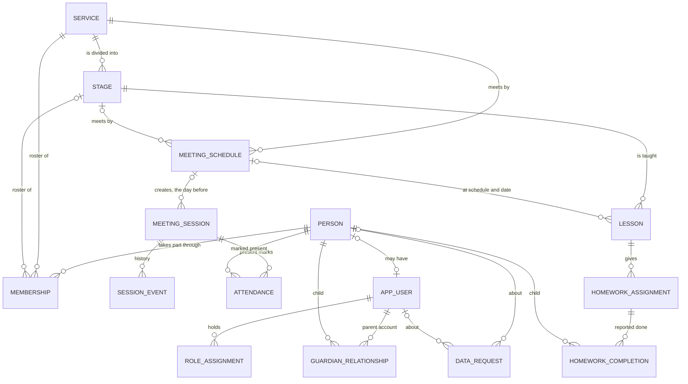

# Data model (proposal)

This is the data model the UI prototype is built on. It is a proposal for this API: the tickets that
build each feature settle the details, and the migrations become the source of truth.

In the `ui` repository, the prototype's TypeScript types (`ui-prototype/src/lib/domain/types.ts`) mirror
the API resources described here, and its mock layer (`ui-prototype/src/server/mock/`) enforces the same
rules. The parked branch `spike/mvp-domain-model` in this repository implemented the attendance part with
Doctrine on Symfony 7.4. It has no lessons, homework or parent access.

## Conventions

- **Ids** are UUIDv7, created by the application.
- **Instants** (`*_at`) are `timestamptz` and are sent as RFC 3339 strings with an offset
  (`2026-11-08T12:00:00+01:00`).
- **Local dates** (`occurrence_date`, `teaching_date`, `due_date`, `starts_on`) are `date` values in the
  church's time zone, Europe/Berlin. Times of day (`start_time`) are `time`. A schedule says "Sundays
  12:00" in local time, so daylight saving time never moves a meeting.
- **History is kept.** Memberships are ended, not deleted. Attendance corrections, homework undos and
  revoked parent access set a timestamp instead of removing the row. Archiving hides things without losing
  them. Only drafts that nobody else saw can be deleted. The exception is erasure on a person's request
  (DSGVO Art. 17), which deletes their personal data for good; see [Data protection](#data-protection).
- **JSON names** in the API are camelCase. Columns are snake_case.
- **Text is stored in Unicode NFC.** What people type is composed first (`InputText::of()`, through
  `ComposedForm`), so "ü" typed as one character or as "u" with a combining diaeresis is one name with one key,
  and lengths count the composed characters. Name keys and emails are composed again after lowering;
  `search_text` stays folded, which gives the same text for either form. One migration per context (Identity,
  Organization, People) composed the rows stored before: names, emails and keys became `normalize(…, NFC)`.
  Lowering keeps canonically equivalent text equivalent, so a composed stored key is exactly the key of the
  composed name; `Version20261110045222Test` checks this against PostgreSQL for every character with a
  canonical decomposition. Where role, service or stage names or emails would have become the same, the
  migration stops and names the rows (accounts by id only) instead of merging them. People may share a key
  (namesakes), so the People migration only composes.
- **Contexts own their tables.** Each context has its own PostgreSQL schema. A reference to another
  context's record is its id without a foreign key, checked by the workflow that writes it; the foreign keys
  in the tables below hold within a context only (see [Code layout](architecture.md#code-layout)).

## Overview

Every child, member and visitor is a **person**. Only people who sign in have an **account** (`app_user`):
staff (administrators, service leaders, servants), parents, and members who asked for an account of their own.
An administrator links a member's account to their own person record, at most one account per record; under 16
only with a parent's or guardian's agreement. Younger children never have accounts of their own.

## Services, stages and people

| Table | Purpose | Key rules |
| --- | --- | --- |
| `service` | A ministry, e.g. Sunday School or Youth Meeting. | Name unique, ignoring case and extra spaces. Archived, never deleted once it has history. |
| `stage` | A group within a service, e.g. 3rd Class. `position` is the display order used everywhere. | Name unique within the service. Archived like services. |
| `person` | Anyone who takes part. `display_name` is an everyday name ("Kiro" for Kirollos). Optional `birth_date` and postal address (`street`, `postal_code`, `city`). | `status` active or inactive. `birth_date` not in the future. The address is all three parts or none. Staff see birth date and address only within their services. |
| `membership` | Puts a person on the roster of a stage, or of the service itself when `stage_id` is null. | `starts_on`, `ends_on` (inclusive). At most one open membership per person and stage, and per person and service-level roster. Stage and service must match. |

`service` and `stage` live in the `organization` schema:

- **Names** are the embeddables `ServiceName` and `StageName` (`name`, `name_key`): runs of Unicode whitespace (no-break spaces
  included) become one space, and the ends are trimmed. `name_key` is the cleaned name in lower case with underscores for spaces
  (`NameKey::of()`), so "  3rd  class" and "3rd Class" share the key `3rd_class`; Arabic has no case and is
  kept as it is. A service name has at most 120 characters (`varchar(120)`), a stage name 80
  (`varchar(80)`). **Descriptions** are the embeddable `Description`: trimmed, at most 2000 and 500
  characters, and blank is stored as null. `description` is `text` with a CHECK on its length, because
  one embeddable serves both tables.
- **Tone** is the embeddable `Tone` (`tone`), the colour slot (1–8) the apps draw a service in.
  `ChurchServices::create()` gives a new service the slot the fewest services use, archived and pending ones
  included, the lowest slot on a tie. It never changes afterwards.
- **Constraints**: UNIQUE `service(name_key)` and `stage(service_id, name_key)`, archived rows included,
  so an archived name is restored instead of created again; UNIQUE `stage(id, service_id)`; CHECK
  `tone` 1–8, non-blank names, description lengths and `position >= 0`; `stage.service_id` references `service` with
  `ON DELETE RESTRICT`; an index on `stage(service_id, position)`. Positions are not unique: writes that
  reorder stages lock the service row instead.
- **The structure lock** (`ServiceRepositoryInterface::withStructureLock()`) locks the service row with `SELECT …
  FOR UPDATE`, forgets the services and stages the request had loaded, and reads them again. So adding, editing,
  reordering, archiving and restoring stages, and archiving and restoring the service, always decide on what the
  previous write committed, never on a copy loaded before the lock.
- **Archiving** a service (`ArchiveServiceWorkflow`) or a stage (`ArchiveStageWorkflow`) runs in the structure lock.
  Meetings' `SchedulePauses` locks the scheduled and active sessions of its schedules; while one is active the
  archive is refused, otherwise the schedules are deactivated in the same transaction. Opening a session checks
  that its service and stage are not archived under the session lock, so an archive and an opening wait for each
  other. Restoring leaves the schedules inactive.
- Other contexts store `service_id` and `stage_id` without foreign keys. The workflows that write them check
  through Organization's `PlacementChoices` that the stage belongs to the service, and they do it under a share
  lock on the service row (`PlacementChoices::whileKept()`, `StructureLookup::whileStageKept()` for lessons): adding or moving a membership,
  importing members, creating a schedule or a one-off session, and creating a lesson. Deleting a service or a stage
  (`DeleteServiceWorkflow`, `DeleteStageWorkflow`) holds the structure lock, so it waits for those writes and they
  wait for it; a write that waited then finds the service or stage gone.
- **Deleting** is for a service or stage created by mistake. Under the structure lock, Meetings' `ScheduleRemovals`
  locks the schedules of the service or stage (so the generator can't add a session meanwhile), counts their
  sessions and, without any, removes them; Learning counts the lessons and People the memberships. Any of the three
  refuses the deletion and the transaction rolls back.

`person` and `membership` live in the `people` schema. A person's names are cleaned like service names; `name_key`
is "first_last" in lower case (indexed, for duplicate checks) and `search_text` is first, last and display
name folded: lower case, without accents or Arabic vowel marks (`InputText::folded()`, ext-intl), so "Mönika
Ḥanna" is found as "monika hanna". First and last name ≤80 characters, display name ≤120 (blank → null);
CHECKs keep `status` to `active`/`inactive`, the names non-blank and the address all three parts or none, and
the application keeps the birth date out of the future. `membership.person_id` references `person` with `ON
DELETE RESTRICT`; `service_id` and `stage_id` are plain ids of Organization records, and the workflow that
writes a membership checks that the stage belongs to the service. CHECK `ends_on >= starts_on`; partial
UNIQUE indexes allow one open membership (`ends_on IS NULL`) per person and stage, and per person and
service-level roster; `(service_id, stage_id)` is indexed for rosters. Adding a membership also keeps a person
either on a service's own roster or on its stages, never both (`people.alreadyInService`); that rule lives in the
application, not in an index, and moving a membership doesn't check it. Ending a membership from today sets
`ends_on` to yesterday; one that started today is deleted instead, the only delete besides erasure.

### Rosters

A roster is computed from membership dates only (D10): person P is on the roster of a stage (or of the service
level, `stage_id` null) on day D when a membership there has `starts_on <= D` and `ends_on` null or `>= D`. A
stage roster holds only that stage; the service-level roster only memberships without a stage. The person's
status doesn't matter, so a person set `inactive` stays on past rosters. People are ordered by last name, then
first name, with the German ICU collation (`de-x-icu`): `Özdemir` sorts between `Nashed` and `Rizk`.
`RosterRepositoryInterface` answers one roster (`rosterOn`), many (service, stage, day) rosters in one statement
(`rostersOn`, through `jsonb_to_recordset`), and today's member counts per service (each person once, plus the
service level) or per stage, one statement for any number of services or stages.

A session's roster is its schedule's roster on the session's `occurrence_date` (#16: sessions have no roster of
their own). The Attendance workflow model `SessionTallies::of()` takes sessions and their schedules that the caller
already looked up, and returns each one's roster ids, present ids and `Counts` (see the API contract) in two more
statements, whatever the number of sessions: one `rostersOn` for the sessions with an expected roster and one DBAL
read of the current marks' (session, person) pairs. Both results are grouped in one pass. Open rosters have no
roster ids.

## Meetings and attendance

| Table | Purpose | Key rules |
| --- | --- | --- |
| `meeting_schedule` | A meeting that repeats: weekly (every n weeks on chosen weekdays) or monthly (the nth or last weekday every n months). Start and end time, place, roster mode. | `roster_mode` is `expected` (the stage or service roster is expected) or `open` (no roster; anyone can be marked present). Inactive schedules stop creating sessions. |
| `meeting_session` | One meeting of a schedule on one date. It keeps its own title, place, start and end time and roster mode, copied from the schedule when it is created. | Unique `(schedule_id, occurrence_date)`, so the generator can't create it twice. A schedule edit copies its new values to the sessions that are still `scheduled` from church-today on; started, closed, canceled and earlier sessions keep theirs, so history and attendance counts stay as they were. |
| `session_event` | The session's history: created, opened, closed, reopened, canceled, edited, with who and an optional note. | Append-only. |
| `attendance` | A "present" mark. | At most one current mark per session and person (`removed_at` null). A correction sets `removed_at`, `removed_by` and a reason. There are no absence rows: not marked present is not the same as absent. |

`meetings.attendance` (`Attendance`, part of Meetings): `session_id`, a foreign key to `meeting_session` with
RESTRICT, so a session with marks can't be deleted; `person_id` (People), a plain id without a foreign key;
`recorded_at`, `recorded_by` and the `Removal` (`removed_at`, `removed_by`, `removal_reason` ≤200, trimmed, blank →
null). The account columns are nulled by the erasure process (D6). No foreign key crosses schemas, so whatever
deletes a person must first check for marks. Partial UNIQUE `attendance_current_unique (session_id, person_id)
WHERE removed_at IS NULL`; CHECKs: removal fields only on a removed mark, `removed_at >= recorded_at`. Indexes on
`session_id` and `person_id`. Attendance writes must run in the session write lock
(`SessionRepositoryInterface::withWriteLock()`): one transaction holding `SELECT … FOR UPDATE` on the
`meeting_session` row, so marks, opening, closing and canceling are serialized per session. The lock reloads the
session from its row, so the work sees what is stored even when the request loaded the session before.

The meeting tables live in the `meetings` schema. A schedule's `Recurrence` is `frequency` (`weekly` or
`monthly`), `interval` (1–52 weeks when weekly, 1–52 months when monthly), `weekdays` (a bitmask of ISO weekdays, Monday = 1 … Sunday = 64, so 1–127),
`month_week` (1–4 or -1 for the last; set exactly when monthly, and then with exactly one weekday) and
`starts_on`/`ends_on` (`ends_on >= starts_on`). CHECKs also keep names non-blank, `end_time >
start_time`, `cancel_reason` only on canceled sessions, `closed_at` exactly on
completed ones and `opened_at` on active and completed ones. `session_event` is append-only:
`by_generator` marks the generator's actor-less `created` events. Foreign keys inside Meetings are
`RESTRICT`: a schedule with sessions and a session with history can't be deleted. `service_id`, `stage_id` (on the schedule) and the actor columns (`opened_by`, `closed_by`,
`actor_id`) are plain ids without foreign keys; the workflows check them, and the erasure process (#82)
nulls the actor columns. Indexes: `meeting_session (occurrence_date)`, `session_event (session_id, occurred_at)`. Every session belongs
to a schedule and sessions are not moved. A one-off session (`CreateOneOffSessionWorkflow`) gets its own hidden
schedule: `one_off = true`, inactive (`CHECK (NOT one_off OR NOT active)`) and recurring once on its date, so its
roster, times and title live where every other session reads them. The generator skips it because it is inactive,
the schedule list leaves it out, and the schedule routes answer 404 for it (`MeetingSchedules::find()` only finds
recurring schedules). `PUT /api/sessions/{id}/details` (`RenameSessionWorkflow`) replaces the title and place in
the session's own plan (`SessionPlan`), which every view, the data export and the mention review read.

Session status: `scheduled` → `active` (attendance open) → `completed` (attendance closed). A service leader
can reopen a completed session for corrections. A scheduled session can be `canceled` with a reason; a
planned date without a session yet can be canceled ahead of time, which creates its session right away so
the generator skips that date.

### Session generation

`GenerateSessionsWorkflow` asks Organization for the archived services and stages, then Meetings'
`SessionGenerator` creates the sessions of today and tomorrow for generating schedules (active, on a service and
stage that are not archived) on the dates their recurrence occurs; `generateFor()` does the same for one schedule.
Per schedule, one transaction locks the schedule row, skips the dates that already have a session and persists
a session with a `created` event (`by_generator`, no actor) for each other date, so `created_at` comes from the
lifecycle callback like everywhere else. Retries and concurrent runs therefore never create a second session and
never touch an existing one, whatever its status; the unique `(schedule_id, occurrence_date)` key stays the last
guard. A failed transaction resets the entity manager before the next schedule. A failing schedule is logged with its id
only, counted as `failed`, and the others go on. The result is `{created, existing, failed}`. The hourly console
command that runs the workflow, with its lock, is #53.

## Accounts and roles

| Table | Purpose | Key rules |
| --- | --- | --- |
| `app_user` | A sign-in account: email, display name, password hash, language (`en`, `de`, `ar`), optional link to the person's own member record (`person_id`), optional `birth_date` and postal address (`street`, `postal_code`, `city`, all three or none; visible to the person and administrators). When the privacy notice was accepted (`privacy_accepted_at`, `privacy_version`). | Email unique, compared in lower case. `approved_at`/`approved_by` stay null until an administrator approves the account; until then it can't sign in. While waiting it keeps what the person wrote when registering (`registered_as` parent, servant or member, `registration_note`, and for servants the services they serve in, `organization.registration_service`); these are cleared once an administrator decides. Declining deletes the row. Disabled accounts (`disabled_at`) can't sign in and keep their history. `erases_on` is set while an erasure the account asked for in the app waits: it can't sign in (`auth.erasureScheduled`), its sessions ended when it was set, and it doesn't count as another administrator for `roles.lastAdministrator`. |
| `role` | A named set of permissions with a `scope`: `church` (the permissions hold everywhere) or `assignedGroups` (they hold in the holder's assigned groups). Administrators create, rename and delete roles and choose their permissions and scope; the defaults are Administrator, Service leader, Servant and Parent. | Name unique, ignoring case and extra spaces. `scope` defaults to `church` (CHECK); Service leader and Servant are seeded with `assignedGroups`. |
| `organization.staff_assignment` | A group an account serves in: `account_id`, `service_id`, `stage_id` (null for the service's own roster and all its stages), `created_at`. | Once per account and group (partial UNIQUE `(account_id, service_id) WHERE stage_id IS NULL` and `(account_id, stage_id) WHERE stage_id IS NOT NULL`). `service_id` and `stage_id` reference `service` and `stage` with `ON DELETE CASCADE`; `account_id` is a plain id of an Identity account, deleted with it. |
| `permission` | One action (`create`, `read`, `update`, `delete`) on one resource (`users`, `roles`, `services`, `stages`, `sessions`, `attendance`, `members`, `lessons`, `homework`, `parentPortal`). | One row per action and resource; seeded. |

`app_user` lives in the `identity` schema. The email is stored trimmed and in lower case (CHECK `email =
lower(btrim(email))`, UNIQUE), so lookups normalize the typed address the same way. CHECKs keep `language` to
`en`, `de`, `ar` and `registered_as` to `parent`, `servant`, `member`; the
registration fields are empty once `approved_at` is set; `person_id` is a plain id of a People person (no
foreign key across schemas), partial UNIQUE `(person_id) WHERE person_id IS NOT NULL`; `age_check`
(`sixteenOrOlder`, `guardianConsent`) and `guardian_consent_note` (≤200) are set only with `person_id`, and the
note only with `guardianConsent`; operators set and remove the link with `app:member:link` and `app:member:unlink`.
`LinkMemberWorkflow` checks the person in People (exists, active, no other account) while it holds a share lock
on the person's row, so an erasure, which locks the row for update and clears the link, can't remove the person in
between. The address is all three parts or none (street ≤120,
postal code ≤10, city ≤80, cleaned, blank → null). A servant who registers names every service they serve in. Those rows live with
the services: `organization.registration_service (account_id, service_id)`, primary key over both, `service_id`
references `service` with `ON DELETE CASCADE`, `account_id` is a plain id of an Identity account. The registration
workflow writes them only for a pending servant, and the workflows that approve, decline or erase an account
delete them. A birth date is never after today: the application checks it against the
church calendar, because a CHECK can't read the date. `approved_by` references `app_user` with `ON DELETE SET
NULL`. Operators create approved accounts with `bin/console app:user:create <email> <name>`, typing the
password twice, piping it with `--password-stdin` or leaving it for a password link with `--no-password`.

Roles are dynamic (RBAC), in the `identity` schema: a user has roles (`user_role`), a role has permissions
(`role_permission`), and a permission is an action on a resource, `{"action": "update", "resource": "sessions"}`.
`permission` holds the catalog, one row per action and resource (UNIQUE), with CHECKs against the enums in code
(`Action`, `Resource`). `role` has a name (≤80, cleaned, unique by `name_key`). Deleting a user or a role removes
its links (`ON DELETE CASCADE`); deleting a role keeps the permissions. An account has a permission when any of
its roles has it; it holds church-wide when one of those roles has the `church` scope, else only in the groups of
the account's `organization.staff_assignment` rows: a service's own roster and its stages for a service assignment,
the stage for a stage assignment (see [Who may do what](architecture.md#who-may-do-what)). The catalog and the defaults Administrator (everything but the
parent portal), Service leader, Servant and Parent (`parentPortal:read`) are seeded by a migration; the roles
are ordinary roles. `app:user:create --role=<name>` writes the account with that role in one transaction.
`app:user:role:add <email> <role>` and `app:user:role:remove <email> <role>` give and take a role by its name
(any case); both go through `RoleAssignments`, the one home of the rules: a role is held once
(`roles.alreadyHasRole`), only a held role can be taken (`roles.notHeld`), a pending account gets roles when it
is approved (`roles.accountPending`), and the last active account that can manage roles (`roles: update`)
keeps that permission (`roles.lastAdministrator`, through `LastAdministrator`; pending and disabled accounts
don't count). Taking a role and disabling an account hold the administration lock (`AdministrationLockInterface`,
a PostgreSQL advisory lock through Symfony Lock on the Doctrine connection) from reading the account until it
is saved, so two changes that run at the same time can't both see the other administrator and leave none.

`password_token` holds one-time password links: `user_id` (CASCADE, indexed), `token_hash` (SHA-256 hex of the
token, UNIQUE; the token itself is never stored), `expires_at` (CHECK `expires_at > created_at`), `used_at`,
`created_at` and `created_by` (SET NULL). A new link deletes the account's unused ones, and the link is emailed
to the account's address (`password_link` template), never printed. `app_user.auth_version`
counts disablings; a session's status fingerprint includes it, so a session from before a disabling stays dead
after enabling.

Sign-in sessions live in `public.sessions` (Symfony's `PdoSessionHandler` table, created by an Identity
migration from `app:migrations:generate identity` and outside every context's schema, so no context's diff touches it). A session holds
only the account id and two crc32c fingerprints: one of the password hash, one of the approval and disabled
times, `auth_version` and, while one is scheduled, `erases_on`. It ends when either changes, so scheduling an
erasure ends every session at once. Because the session stores fingerprints and no objects,
a session saved before a change to the account's shape restores with empty fingerprints and ends cleanly.

The backend checks every request against these roles. The frontend only uses them to hide actions a person
can't take.

Account states: registered (waiting) → approved → disabled. Approving a parent creates approved
`guardian_relationship` rows for the children the administrator chose; approving a servant gives them their
roles and the groups they serve in (`staff_assignment`), and deletes the services they named. A parent account without any approved child sees an empty portal.

## Lessons, homework and parent access

| Table | Purpose | Key rules |
| --- | --- | --- |
| `lesson` | What is taught at one meeting of a stage: title, summary, passage, memory verse, objectives, teaching points, activities, materials, notes for the servants. A responsible servant and helpers (`lesson_collaborator`). | Linked to its meeting by `(schedule_id, teaching_date)`, the same key as the session, so it can be prepared weeks before the session exists. At most one non-archived lesson per meeting. |
| `homework_assignment` | A small task for the children of the lesson's stage: title, instructions for parents, optional due date, resources. | `stage_id` is the lesson's stage. The due date can't be before the lesson. `published_at` stays set once it was published. |
| `homework_completion` | A report that one person did one task, by an approved guardian or by the member's own account. | At most one current report per task and person (`undone_at` null). Reporting twice keeps the first report, whoever made it. Undo sets `undone_at` and `undone_by`. Only an approved guardian of the person or the account linked to the person's own record can report, and only while the task is published. |
| `guardian_relationship` | Links a parent account to a child: `parent` or `guardian`. In the `people` schema. | `approved` → `revoked` (the row stays). Only administrators create links. At most one non-revoked link per account and child (partial UNIQUE `(user_id, person_id) WHERE status <> 'revoked'`). `person_id` references `person` with `ON DELETE CASCADE`; `user_id`, `approved_by` and `revoked_by` are plain account ids (no foreign keys across schemas): deleting or erasing an account deletes its links in the workflow (#82). CHECKs on `relationship`, `status` and `(status = 'revoked') = (revoked_at IS NOT NULL)`. |

`learning.lesson` (`Lesson`): `stage_id` (Organization) and `schedule_id` (Meetings) are plain ids without foreign
keys, checked by the workflows; `teaching_date`; `responsible_id` is an account id nulled by the erasure process
(D6). Text: `title` ≤160, `summary` ≤1000, `passage` ≤200, `memory_verse` ≤500; plan: `objectives`,
`teaching_points`, `activities`, `notes` ≤4000 each; `materials` is a jsonb list of `{url, label}` (≤10 rows,
written label ≤120, `http(s)` links ≤2048 without credentials; empty rows dropped, a link without a label is its
own label; stored as `{url, label}`, jsonb's key order); `status`, `completed_at`, `archived_at`, timestamps.
CHECKs: status enum, `(status = 'completed') = (completed_at IS NOT NULL)`, `btrim(title) <> ''`,
`jsonb_array_length(materials) <= 10`. Partial UNIQUE `(schedule_id, teaching_date) WHERE archived_at IS NULL`
(lessons without a schedule never clash); index `(stage_id, teaching_date)`. No foreign key crosses schemas, so
whatever deletes a stage or a schedule must first check for lessons. A lesson
linked to a schedule date holds a share lock on the schedule row while it is written, and `DeleteScheduleWorkflow`
locks the row for update before it counts the schedule's sessions and lessons, so a deletion and a new lesson wait
for each other and no lesson is left pointing at a deleted schedule. A lesson linked to a session needs no lock: a
schedule with sessions can't be deleted, and the generator creates sessions under the same row lock.

Lesson status: `draft` → `ready` → `completed` (taught). Completed is only possible on or after the teaching
date, and each step can be undone. Lessons are archived; a draft lesson can be deleted while none of its
homework was ever published.

`learning.homework_assignment` (`HomeworkAssignment`): `lesson_id` (RESTRICT, so deleting a draft lesson deletes
its draft homework first); `stage_id`, the lesson's stage, fixed when the task is created; `title` ≤120 (spaces
collapsed, required), `instructions` ≤2000 (trimmed, newlines kept, required), `due_date`, `resources` (jsonb, the
lesson's `Material` rules, ≤10), `status`, `published_at`, `archived_at`, `created_by` (an account id nulled by the
erasure process), timestamps. CHECKs: status enum, published needs `published_at`, `(status = 'archived') =
(archived_at IS NOT NULL)`, non-blank title, non-blank instructions ≤2000, ≤10 resources. Indexes `(stage_id,
status)` and `lesson_id`. Lifecycle changes and parents' reports take the task row `FOR UPDATE`
(`HomeworkRepositoryInterface::withLock()`), so "back to draft" and a new report never interleave. The due date is
checked against the lesson's date by the workflow (#60), because it spans two rows.

`learning.homework_completion` (`HomeworkCompletion`): `assignment_id` (RESTRICT), `person_id` (People, plain id),
`completed_at`, `completed_by`, `undone_at`, `undone_by` (account ids nulled by erasure). Partial UNIQUE
`(assignment_id, person_id) WHERE undone_at IS NULL`; CHECKs: `undone_by` only with `undone_at`, `undone_at >=
completed_at`; index `person_id`.

Homework status: `draft` → `published` → `archived`. Drafts are never visible to parents. Published homework
goes back to draft only while no parent has reported it done; after that it can only be archived. Archiving
removes it from the parent portal and keeps the reports.

### What parents receive

The parent read models contain only the parent's own approved children, their current stage, published
homework (title, instructions, due date, resources) and the lesson's title, date, passage and memory verse. Lesson plans,
notes for the servants, attendance, other children and other families are never part of them. "Done" means
a parent ticked it off; it says nothing about how well the child learned, and nothing is graded or ranked.

### What members receive

A member's read models contain only their own record's groups (current memberships in active services and
stages), the schedules and servants of those groups, the last lesson's title, date, passage and memory verse,
the next two weeks' meetings (canceled ones without the reason) and the published homework of their stages
with the same audience and reports as the parent portal. The person always comes from the account's `person_id`,
never from the request. Attendance, notes for the servants, cancel reasons, lesson plans and other members are
never part of them.

### Who a task is for

A task goes to everyone currently on the stage's roster, so a child who joins later sees the stage's
published homework. A child who left keeps the reports already made, shown as no longer in the stage.

In numbers (`TaskAudiences`), for church-today in Europe/Berlin:

- **In the stage:** active people with a membership in the task's stage that has started (`starts_on` ≤ today) and
  not ended (`ends_on` null or ≥ today, the last day included).
- **Left with a report:** people with a current report (not undone) who are no longer in the stage; they are
  listed with `inStage: false` and count only in `reportedTotal`. Someone who left without a report is not listed.
- `assigned` = in the stage; `completed` = in the stage with a current report; `notCompleted` = the rest;
  `completedAfterDueDate` = in-stage reports whose Berlin date is after `due_date` (never without one);
  `withoutParentAccount` = in-stage children with no report and no approved guardian link to an active account;
  `withoutAccount` = in-stage people with no report, no such parent account and no active account of their own
  (members, #142), so it equals `withoutParentAccount` where nobody has an own account; `reportedTotal` = every
  current report.
- A row's `ownAccount` says the person has an active account of their own, also for someone listed only because
  of a report after leaving; `reportedBySelf` says that account made the current report.
- The parent portal (`VisibleHomework`) and the member portal (`OwnHomework`) use the same condition for the tasks
  a child or a member sees: the task is `published`, and the person is in its stage today (active, membership
  current) or has a current report. For a parent the viewer is an active account with an approved link to the
  child; for a member it is the active account linked to the record (`MemberCheck`). Every read and write goes
  through it, with the viewer, never a bare person id.

## Data protection

| Table | Purpose | Key rules |
| --- | --- | --- |
| `data_request` | A request to see (`copy`) or erase (`erasure`) personal data: who it is about (`person_id`, `app_user_id`), who asked and how (`requested_by`, `channel`: app, email, letter, in person), `received_at`, `due_on` (one month later), for an erasure made in the app `erases_on` (14 days later), a note, and the outcome. | `status` open → done, declined or withdrawn (an erasure from the app cancelled before `erases_on`); declining needs a reason; only an erasure from the app has `erases_on` (CHECK). `closed_by` stays null when the request closes without the office: a scheduled erasure, a withdrawal, a downloaded copy. A member's account and an account's member record belong to the same request. The subject's name is never stored: it is read from `person`/`app_user` while they exist. Once the data is erased, `person_id`/`app_user_id` become null and `erased_subject_kind`/`_group` say what it was ("member of 3rd Class"), also on earlier requests about the same person. `outcome` counts what was deleted per kind. |
| `copy_link` | A one-time download link for a copy request: the SHA-256 hash of its token (unique), `expires_at` (7 days), `used_at`, and `recipient_id`, the account it was emailed to. | Only the newest unused link of a request works; creating one deletes the unused ones. Spending it and closing the request happen in one transaction (`UPDATE … WHERE used_at IS NULL AND expires_at > now`), so a copy is delivered once. `recipient_id` becomes null when that account is erased. |

### What a copy request exports

`app:privacy:export` writes one JSON file (camelCase keys, RFC 3339 instants in Europe/Berlin, local dates, a
fixed order) for `kind: member` or `kind: account`:

- **member:** `member` (names, status, `recordedSince`), `memberships` (service, stage, from, until),
  `attendance` (meeting, date, `markedPresentAt`, `removedAt`, `removalNote`), `homeworkReports`
  (homework, `completedAt`, `undoneAt`) and `parentAccounts` (name and link status only).
- **account:** `account` (email, name, language, `createdAt`, `approvedAt`, `disabledAt`,
  `privacyNoticeAccepted {at, version}`, role names, the registration while pending, `memberAgeCheck {result,
  parentAgreed}` or `null`), `children` (name and link status), the `homeworkReports` it made and `memberRecord`:
  for an account linked to its own member record that record's member copy (a member's account and an account's
  member record belong to the same request), else `null`.
- **Never:** password hashes, password-link tokens, session data, other people's email addresses (Art. 15(4)),
  notes by others that mention the person.

The file is first written as a new owner-only (`0600`) file beside the target and then renamed over it, so an
existing file with wider permissions never holds the personal data. `recordedSince` is the church date of the
record's creation.

### What erasing deletes, and what stays

For a **member** (`person`): the person row, their memberships, attendance marks (corrections included),
homework reports about them and their guardian links. Notes written by others that may name them
(cancel reasons, session notes, correction notes, lesson notes in their groups) are listed for the
administrator, who can have them emptied in the same step. A data request about the record also erases the
account linked to it (and a request about an account its member record): they belong to the same request. Reports
a member made for themselves are about them and go with the record. `app:privacy:erase-person` on its own only
removes the account's link.

`app:privacy:erase-person` runs `ErasePersonWorkflow` in one transaction; its `:dry-run` runs the same
workflow inside a transaction that always rolls back:

1. People's `PersonErasures` locks the person row and hands every `PersonReferences`
   (`Platform\Privacy\Contract`) an `ErasedPerson`: their names, memberships, last group and a way to ask
   which roster slots they were on.
2. Meetings' `PersonTraces` finds the counted sessions they were on the roster of or marked present at.
   Each session's counters are raised in the database (`erased_present = erased_present + 1`), not from a
   loaded session, so two erasures that share a session both count. Then it deletes the attendance marks.
3. Privacy's `PersonTraces` leaves every request about the member with only `erased_subject_kind` `member` and
   `erased_subject_group`, the member's last stage or else its service.
4. Learning's `PersonTraces` deletes the homework reports, and Identity's `PersonTraces` clears an account's link
   to the person's own record (`person_id`, `age_check`, `guardian_consent_note`).
5. People deletes the memberships, guardian links and the person.

An erasure request does the same from the app (`EraseRequestSubjectWorkflow`), and its review runs that workflow
inside a transaction that is rolled back. It resolves the counterpart first: Identity's `AccountErasures` names
the account linked to the requested record (`accountOfRecord`) or the record of the requested account
(`recordOfAccount`), so a member's account and its record belong to the same request. The notes that name the
member (`PersonErasures::mentionsOf`, from every `PersonNotes`) are found by the member's first and display name
as a whole word, oldest first:

- cancel reasons and session notes in the meetings of the member's stages, and in their services' meetings
  without a stage;
- other members' removal reasons in those meetings;
- lesson notes of the member's stages.

**Lock order.** Every erasure takes its locks in the same order, so two of them, or an erasure and a write,
wait for each other instead of deadlocking:

1. the data request (from the app);
2. the person;
3. role administration, as a transaction lock that is held until the outermost transaction commits, so a
   second erasure sees the first one's result before it checks for the last administrator;
4. the account;
5. the rows that point at them.

Writers that add data about a person hold a share lock on the person row before they lock the session, the
homework task or the account: marking someone present, a parent reporting homework done, and linking an account
to its member record. So none of these writes can slip in after the erasure has cleaned up.

For an **account** (`app_user`): the account, its roles, the groups it serves in (`staff_assignment`) and guardian
links, with its link to a member record, the age check and the agreement note. `app:privacy:erase-account` keeps the member record and the reports about it,
with `completed_by` null. What the account did for the
church stays, without saying who: attendance it recorded, sessions it closed, history entries, homework
reports it made for a child (they are about the child), lessons and homework it prepared. The columns that
point to the account become null (`recorded_by`, `removed_by`, `closed_by`, `actor_id`, `undone_by`,
`approved_by`, …); `homework_completion.completed_by`, `lesson.responsible_id` and
`homework_assignment.created_by` are nullable for this reason, and the apps show "a former account".

`app:privacy:erase-account` (and its `:dry-run`, which rolls the same steps back) runs
`EraseAccountWorkflow`. Identity's `AccountErasures` locks role administration and the account row, refuses
the last administrator, counts the roles and password links, lets every context forget the account, and
deletes it in one transaction. Each context forgets through its `AccountTraces` service, which implements the
`AccountReferences` platform contract and nulls its actor columns or deletes the rows the account owned;
Identity's `AccountSweeps` collects them by the contract's tag, so a new context only adds its own service. A
request that was already running can still write the account's id after that transaction, so `AccountErasures`
sweeps the contexts once more after the commit (an erasure request once more after its own transaction), and a
rerun on an erased account sweeps again before it reports `notFound.account`.

**Past totals stay right.** A session's counts ("12 of 14 present") would shrink when someone is erased.
Three counters on `meeting_session` keep them: `erased_roster`, `erased_present` and
`erased_roster_present`, increased for every completed, active or past session the person was on the roster
of or marked present at. The counts add them; the lists no longer show the person.

The copy (`copy` requests and the download on the account page) is JSON with the member's record
(birth date and address included), memberships, attendance and homework reports, and the account's details (birth date and address included), roles, linked children and the
reports it made. Password hashes and other people's contact details are never part of it.

Retention is an open question for the church (see the architecture's open questions): how long members
who left and disabled accounts are kept before they are erased the same way.
