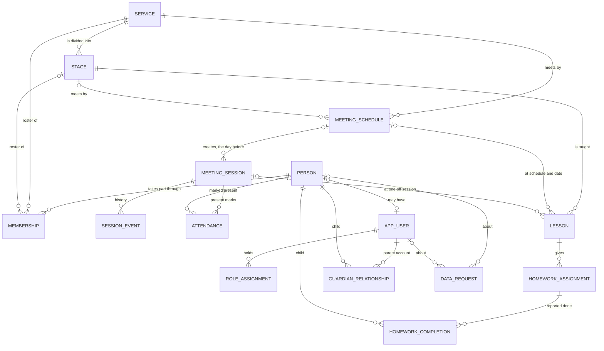

# Data model (proposal)

This is the data model the UI prototype is built on. It is a proposal for this API: the tickets that
build each feature settle the details, and the migrations become the source of truth.

In the `ui` repository, the prototype's TypeScript types (`ui-prototype/src/lib/domain/types.ts`) mirror
the API resources described here, and its mock layer (`ui-prototype/src/server/mock/`) enforces the same
rules. The parked branch `spike/mvp-domain-model` in this repository implemented the attendance part with
Doctrine on Symfony 7.4. It has no lessons, homework or parent access.

## Conventions

- **Ids** are UUIDv7, created by the application.
- **Instants** (`*_at`) are `timestamptz` and are sent as RFC 3339 strings with an offset
  (`2026-11-08T12:00:00+01:00`).
- **Local dates** (`occurrence_date`, `teaching_date`, `due_date`, `starts_on`) are `date` values in the
  church's time zone, Europe/Berlin. Times of day (`start_time`) are `time`. A schedule says "Sundays
  12:00" in local time, so daylight saving time never moves a meeting.
- **History is kept.** Memberships are ended, not deleted. Attendance corrections, homework undos and
  revoked parent access set a timestamp instead of removing the row. Archiving hides things without losing
  them. Only drafts that nobody else saw can be deleted. The exception is erasure on a person's request
  (DSGVO Art. 17), which deletes their personal data for good; see [Data protection](#data-protection).
- **JSON names** in the API are camelCase. Columns are snake_case.
- **Contexts own their tables.** Each context has its own PostgreSQL schema. A reference to another
  context's record is its id without a foreign key, checked by the use case that writes it; the foreign keys
  in the tables below hold within a context only (see [Code layout](architecture.md#code-layout)).

## Overview

Every child, member and visitor is a **person**. Only people who sign in have an **account** (`app_user`):
staff (administrators, service leaders, servants) and parents. Children never have accounts.

## Services, stages and people

| Table | Purpose | Key rules |
| --- | --- | --- |
| `service` | A ministry, e.g. Sunday School or Youth Meeting. | Name unique, ignoring case and extra spaces. Archived, never deleted once it has history. |
| `stage` | A group within a service, e.g. 3rd Class. `position` is the display order used everywhere. | Name unique within the service. Archived like services. |
| `person` | Anyone who takes part. `display_name` is an everyday name ("Kiro" for Kirollos). Optional `birth_date` and postal address (`street`, `postal_code`, `city`). | `status` active or inactive. `birth_date` not in the future. The address is all three parts or none. Staff see birth date and address only within their services. |
| `membership` | Puts a person on the roster of a stage, or of the service itself when `stage_id` is null. | `starts_on`, `ends_on` (inclusive). At most one open membership per person and stage, and per person and service-level roster. Stage and service must match. |

`service` and `stage` live in the `organization` schema:

- **Names** are the embeddables `ServiceName` and `StageName` (`name`, `name_key`): runs of Unicode whitespace (no-break spaces
  included) become one space, and the ends are trimmed. `name_key` is the cleaned name in lower case with underscores for spaces
  (`NameKey::of()`), so "  3rd  class" and "3rd Class" share the key `3rd_class`; Arabic has no case and is
  kept as it is. A service name has at most 120 characters (`varchar(120)`), a stage name 80
  (`varchar(80)`). **Descriptions** are the embeddable `Description`: trimmed, at most 2000 and 500
  characters, and blank is stored as null. `description` is `text` with a CHECK on its length, because
  one embeddable serves both tables.
- **Tone** is the embeddable `Tone` (`tone`), the colour slot (1–8) the apps draw a service in. A
  `prePersist` entity listener (`ToneListener`) gives a new service the slot the fewest services use,
  archived ones included, the lowest slot on a tie. It never changes afterwards.
- **Constraints**: UNIQUE `service(name_key)` and `stage(service_id, name_key)`, archived rows included,
  so an archived name is restored instead of created again; UNIQUE `stage(id, service_id)`; CHECK
  `tone` 1–8, non-blank names, description lengths and `position >= 0`; `stage.service_id` references `service` with
  `ON DELETE RESTRICT`; an index on `stage(service_id, position)`. Positions are not unique: writes that
  reorder stages lock the service row instead.
- Other contexts store `service_id` and `stage_id` without foreign keys. The use cases that write them
  check through `StageRepositoryInterface::belongsTo()` that the stage belongs to the service.

## Meetings and attendance

| Table | Purpose | Key rules |
| --- | --- | --- |
| `meeting_schedule` | A meeting that repeats: weekly (every n weeks on chosen weekdays) or monthly (the nth or last weekday). Start and end time, place, roster mode. | `roster_mode` is `expected` (the stage or service roster is expected) or `open` (no roster; anyone can be marked present). Inactive schedules stop creating sessions. |
| `meeting_session` | One meeting on one date. Created from a schedule, or by hand as a one-off (`schedule_id` null). | Unique `(schedule_id, occurrence_date)`. `occurrence_date` is the schedule date the session stands for and never changes, even when the session is moved, so the generator can't create it twice. `overridden` marks sessions changed by hand; later schedule edits leave them alone. |
| `session_event` | The session's history: opened, closed, reopened, canceled, moved, edited, with who and an optional note. | Append-only. |
| `attendance` | A "present" mark. | At most one current mark per session and person (`removed_at` null). A correction sets `removed_at`, `removed_by` and a reason. There are no absence rows: not marked present is not the same as absent. |

Session status: `scheduled` → `active` (attendance open) → `completed` (attendance closed). A service leader
can reopen a completed session for corrections. A scheduled session can be `canceled` with a reason; a
planned date without a session yet can be canceled or moved ahead of time, which creates its session right
away so the generator skips that date.

### Session generation (backend job, not built yet)

A scheduled console command runs every hour at minute 5. It creates the sessions of active schedules on the
calendar day before they take place, and covers today as well in case a run was missed. It is idempotent:
the unique `(schedule_id, occurrence_date)` key makes a second run a no-op, and a date that already has a
session (moved or canceled included) is never touched again. The prototype simulates this job on its demo
clock; it does not exist in the backend yet.

## Accounts and roles

| Table | Purpose | Key rules |
| --- | --- | --- |
| `app_user` | A sign-in account: email, display name, password hash, language (`en`, `de`, `ar`), optional link to a person, optional `birth_date` and postal address (`street`, `postal_code`, `city`, all three or none; visible to the person and administrators). When the privacy notice was accepted (`privacy_accepted_at`, `privacy_version`). | Email unique, compared in lower case. `approved_at`/`approved_by` stay null until an administrator approves the account; until then it can't sign in. While waiting it keeps what the person wrote when registering (`registered_as` parent or servant, `registration_note`, and for servants the services they serve in, `organization.registration_service`); these are cleared once an administrator decides. Declining deletes the row. Disabled accounts (`disabled_at`) can't sign in and keep their history. |
| `role` | A named set of permissions. Administrators create, rename and delete roles and choose their permissions from the catalog; the defaults are Administrator, Service leader, Servant and Parent. | Name unique, ignoring case and extra spaces. |
| `permission` | One action (`create`, `read`, `update`, `delete`) on one resource (`users`, `roles`, `services`, `stages`, `sessions`, `attendance`, `members`, `lessons`, `homework`, `parentPortal`). | One row per action and resource; seeded. |

`app_user` lives in the `identity` schema. The email is stored trimmed and in lower case (CHECK `email =
lower(btrim(email))`, UNIQUE), so lookups normalize the typed address the same way. CHECKs keep `language` to
`en`, `de`, `ar` and `registered_as` to `parent`, `servant`; the
registration fields are empty once `approved_at` is set; the address is all three parts or none (street ≤120,
postal code ≤10, city ≤80, cleaned, blank → null). A servant who registers names every service they serve in. Those rows live with
the services: `organization.registration_service (account_id, service_id)`, primary key over both, `service_id`
references `service` with `ON DELETE CASCADE`, `account_id` is a plain id of an Identity account. The registration
use case writes them only for a pending servant, and the use cases that approve, decline or erase an account
delete them. A birth date is never after today: the application checks it against the
church calendar, because a CHECK can't read the date. `approved_by` references `app_user` with `ON DELETE SET
NULL`. Operators create approved accounts with `bin/console app:user:create <email> <name>`, typing the
password twice, piping it with `--password-stdin` or leaving it for a password link with `--no-password`.

Roles are dynamic (RBAC), in the `identity` schema: a user has roles (`user_role`), a role has permissions
(`role_permission`), and a permission is an action on a resource, `{"action": "update", "resource": "sessions"}`.
`permission` holds the catalog, one row per action and resource (UNIQUE), with CHECKs against the enums in code
(`Action`, `Resource`). `role` has a name (≤80, cleaned, unique by `name_key`). Deleting a user or a role removes
its links (`ON DELETE CASCADE`); deleting a role keeps the permissions. `User::can($action, $resource)` is true when
any of the user's roles has that permission. The catalog and the defaults Administrator (everything but the
parent portal), Service leader, Servant and Parent (`parentPortal:read`) are seeded by a migration; the roles
are ordinary roles. `app:user:create --role=<name>` writes the account with that role in one transaction.

Sign-in sessions live in `public.sessions` (Symfony's `PdoSessionHandler` table, created by an Identity
migration from `app:migrations:generate identity` and outside every context's schema, so no context's diff touches it). A session holds
only the account id, a crc32c fingerprint of the password hash and the approval and disabled times; it ends
when either changes.

The backend checks every request against these roles. The frontend only uses them to hide actions a person
can't take.

Account states: registered (waiting) → approved → disabled. Approving a parent creates approved
`guardian_relationship` rows for the children the administrator chose; approving a servant gives them their
roles. A parent account without any approved child sees an empty portal.

## Lessons, homework and parent access

| Table | Purpose | Key rules |
| --- | --- | --- |
| `lesson` | What is taught at one meeting of a stage: title, summary, passage, memory verse, objectives, teaching points, activities, materials, notes for the servants. A responsible servant and helpers (`lesson_collaborator`). | Linked to its meeting by `(schedule_id, teaching_date)`, the same key as the session, so it can be prepared weeks before the session exists and survives the session being moved. One-off sessions are linked by `session_id`. At most one non-archived lesson per meeting. |
| `homework_assignment` | A small task for the children of the lesson's stage: title, instructions for parents, optional due date, resources. | `stage_id` is the lesson's stage. The due date can't be before the lesson. `published_at` stays set once it was published. |
| `homework_completion` | A parent's report that one child did one task. | At most one current report per task and child (`undone_at` null). Reporting twice keeps the first report. Undo sets `undone_at` and `undone_by`. Only an approved guardian of the child can report, and only while the task is published. |
| `guardian_relationship` | Links a parent account to a child: `parent` or `guardian`. | `pending` → `approved` → `revoked`. Only administrators approve or create links. At most one non-revoked link per account and child. |

Lesson status: `draft` → `ready` → `completed` (taught). Completed is only possible on or after the teaching
date, and each step can be undone. Lessons are archived; a draft lesson can be deleted while none of its
homework was ever published.

Homework status: `draft` → `published` → `archived`. Drafts are never visible to parents. Published homework
goes back to draft only while no parent has reported it done; after that it can only be archived. Archiving
removes it from the parent portal and keeps the reports.

### What parents receive

The parent read models contain only the parent's own approved children, their current stage, published
homework (title, instructions, due date, resources) and the lesson's passage and memory verse. Lesson plans,
notes for the servants, attendance, other children and other families are never part of them. "Done" means
a parent ticked it off; it says nothing about how well the child learned, and nothing is graded or ranked.

### Who a task is for

A task goes to everyone currently on the stage's roster, so a child who joins later sees the stage's
published homework. A child who left keeps the reports already made, shown as no longer in the stage.

## Data protection

| Table | Purpose | Key rules |
| --- | --- | --- |
| `data_request` | A request to see (`copy`) or erase (`erasure`) personal data: who it is about (`person_id`, `app_user_id`), who asked and how (`requested_by`, `channel`: app, email, letter, in person), `received_at`, `due_on` (one month later), a note, and the outcome. | `status` open → done or declined; declining needs a reason. A member's account and an account's member record belong to the same request. Once the data is erased, the request keeps no name: `subject_name` is cleared and `erased_subject` says what it was ("member of 3rd Class"), and the same happens to earlier requests about the same person. `outcome` counts what was deleted per kind. |

### What erasing deletes, and what stays

For a **member** (`person`): the person row, their memberships, attendance marks (corrections included),
homework reports about them and their guardian links. Notes written by others that may name them
(cancel reasons, session notes, correction notes, lesson notes in their groups) are listed for the
administrator, who can have them emptied in the same step. A linked account loses the link.

For an **account** (`app_user`): the account, its roles and guardian links. What the account did for the
church stays, without saying who: attendance it recorded, sessions it closed, history entries, homework
reports it made for a child (they are about the child), lessons and homework it prepared. The columns that
point to the account become null (`recorded_by`, `removed_by`, `closed_by`, `actor_id`, `undone_by`,
`approved_by`, …); `homework_completion.completed_by`, `lesson.responsible_id` and
`homework_assignment.created_by` are nullable for this reason, and the apps show "a former account".

**Past totals stay right.** A session's counts ("12 of 14 present") would shrink when someone is erased.
Three counters on `meeting_session` keep them: `erased_roster`, `erased_present` and
`erased_roster_present`, increased for every completed, active or past session the person was on the roster
of or marked present at. The counts add them; the lists no longer show the person.

The copy (`copy` requests and the download on the account page) is JSON with the member's record
(birth date and address included), memberships, attendance and homework reports, and the account's details (birth date and address included), roles, linked children and the
reports it made. Password hashes and other people's contact details are never part of it.

Retention is an open question for the church (see the architecture's open questions): how long members
who left and disabled accounts are kept before they are erased the same way.
